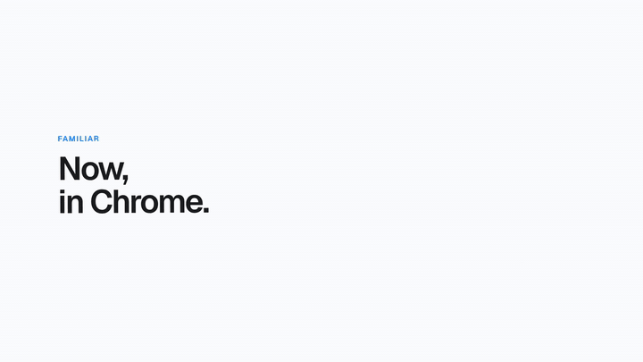

# CodeSafe

Your Gmail codes, one click away.

CodeSafe is a Chrome extension that brings the iPhone "From Messages" code suggestion to Chrome. When you focus a verification-code field, a small pill appears above it with the latest code from your Gmail. Click it and the code is filled in.

[](docs/codesafe-film.mp4)

**[Watch the 30-second film (MP4)](docs/codesafe-film.mp4)**

## How it works

1. Focus a code field on any site.
2. CodeSafe checks the last 10 minutes of your Gmail and shows the code above the field.
3. Click the pill (or press ⌘⇧V / Ctrl+Shift+V). Done.

## Privacy

- No server. The extension talks directly to Google's Gmail API from your browser.
- Read-only access (`gmail.readonly`). It can never send, delete or change mail.
- Looks only when you focus a code field, and only at recent messages that look like they contain a code.
- The code is kept in session memory for 5 minutes, then wiped.

## Repository layout

| Path | What it is |
| --- | --- |
| `extension/` | The Chrome extension (Manifest V3, TypeScript, esbuild). Setup guide in [`extension/README.md`](extension/README.md). |
| `artifacts/codetap-web/` | The landing page (React + Vite + Tailwind) with the download and privacy policy. |
| `artifacts/codetap-video/` | The animated explainer film (React + Framer Motion). |
| `docs/` | The exported film and demo GIF. |

## Install (developer mode)

```bash
pnpm install
pnpm --filter @workspace/codesafe-extension run build
```

Open `chrome://extensions`, turn on Developer mode, choose **Load unpacked**, and select `extension/dist`. Google sign-in needs a one-time OAuth setup; see [`extension/README.md`](extension/README.md).

## Develop

```bash
pnpm --filter @workspace/codetap-web run dev        # landing page
pnpm --filter @workspace/codesafe-extension run test # extractor tests
pnpm --filter @workspace/codesafe-extension run zip  # rebuild the downloadable zip
```
